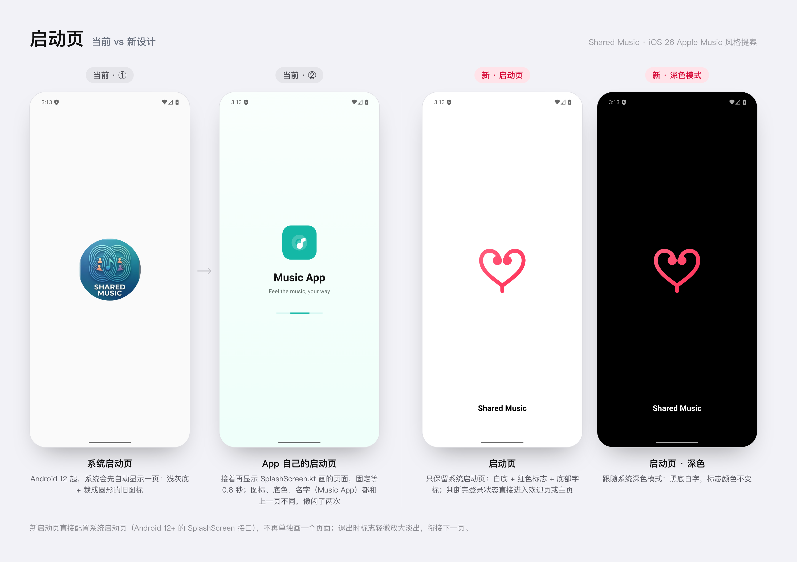
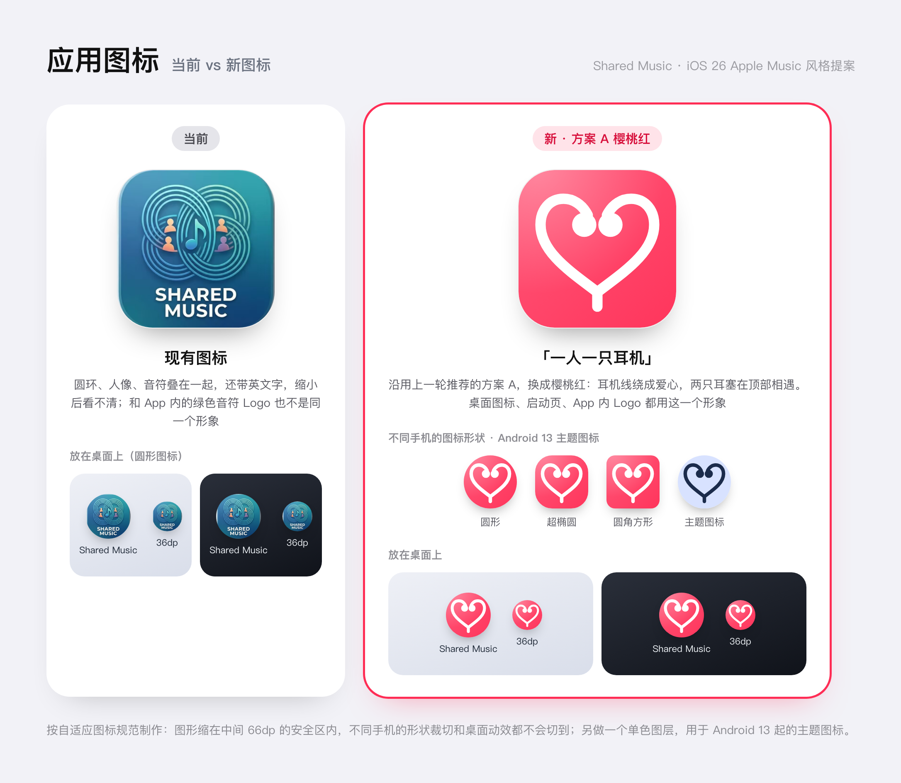
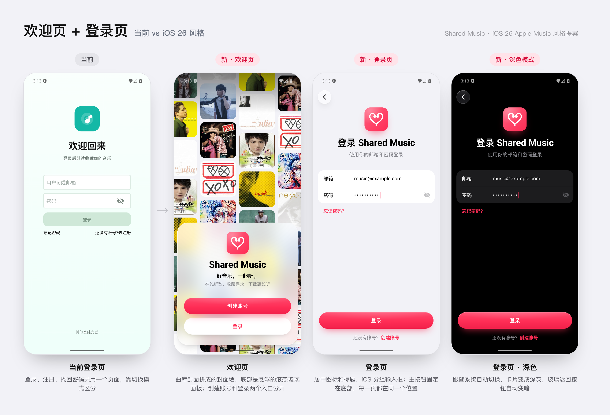
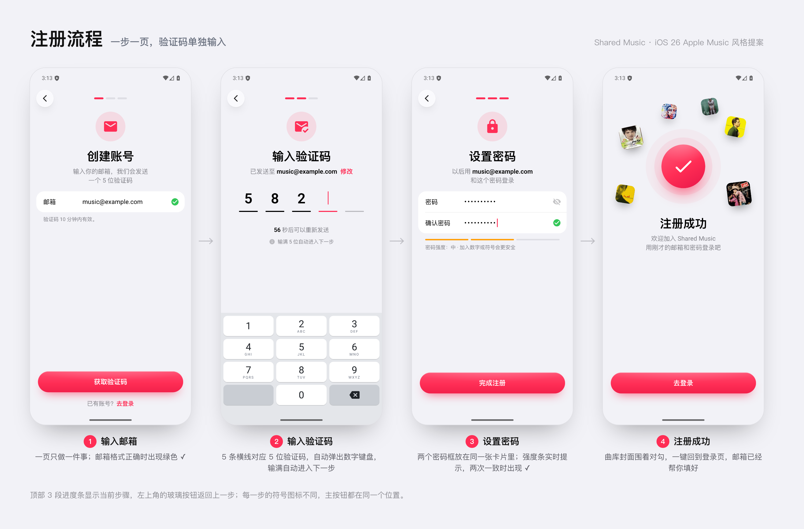
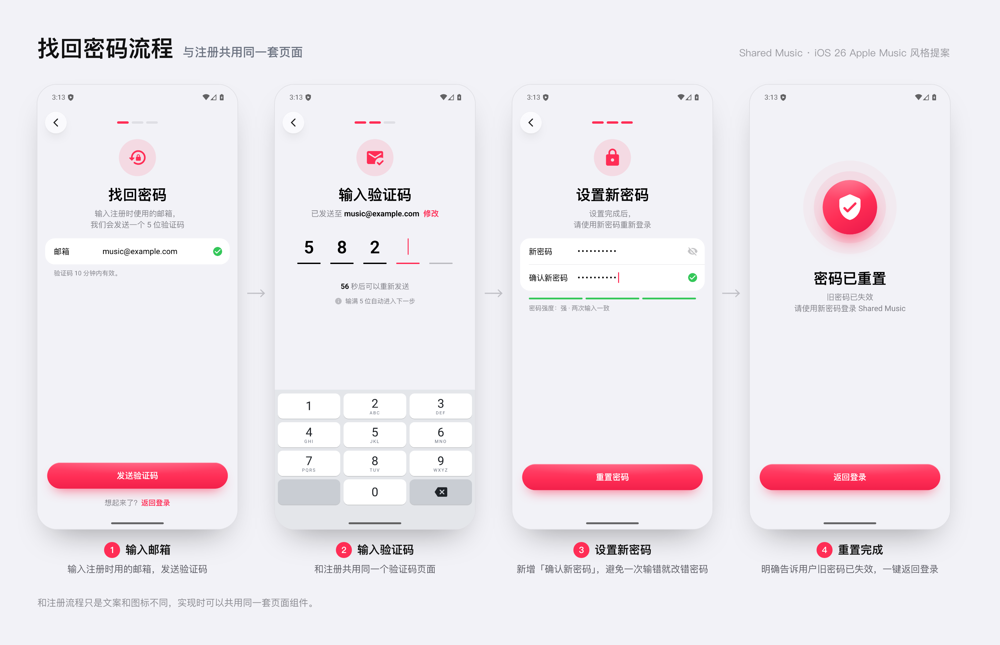
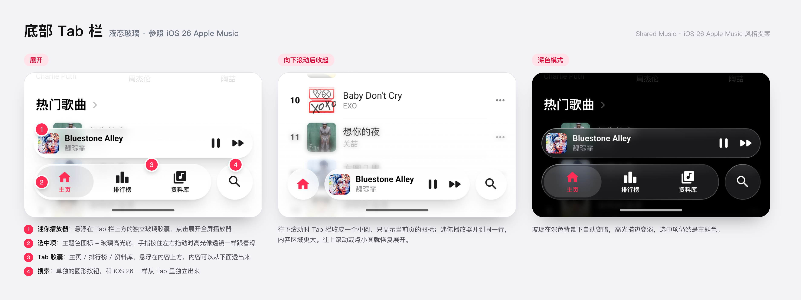
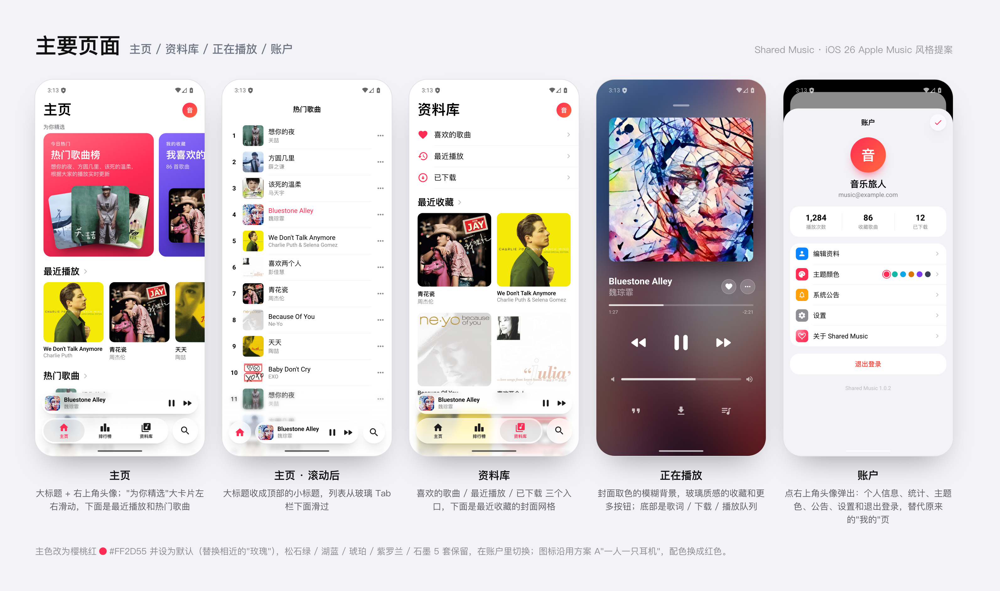

# Shared Music UI 改版方案（iOS 26 Apple Music 风格）

> 状态：阶段 1 基本完成（主题色、图标、启动页、欢迎页、登录注册），阶段 2–4 还没开始。
> 设计图是用 HTML 原型渲染的效果图，按 Pixel 7（411 × 914 dp）绘制。图里的封面来自曲库里的歌曲。
> 设计图都在 [`docs/ui-redesign/`](docs/ui-redesign/) 目录下。
> 更新日期：2026-10-15

## 目录

1. [设计目标](#1-设计目标)
2. [设计图](#2-设计图)
3. [设计规范](#3-设计规范)
4. [任务清单](#4-任务清单)
5. [需要后端配合的地方](#5-需要后端配合的地方)
6. [风险与注意事项](#6-风险与注意事项)
7. [待确认的问题](#7-待确认的问题)
8. [附：已完成的逻辑修复](#8-附已完成的逻辑修复)

---

## 1. 设计目标

- **整体风格**：参照 iOS 26 的 Apple Music，主要特征如下：
  - 液态玻璃材质的悬浮 Tab 栏和迷你播放器。
  - 大标题导航。
  - iOS 风格的分组列表。
  - 胶囊形状的按钮。
- **品牌统一**：主色换成樱桃红 `#FF2D55`。应用图标、启动页和 App 内的 Logo 统一换成新的「一人一只耳机」形象。
- **启动页**：现在冷启动会连续出现两个不一样的启动页，改成只显示一个。
- **登录注册**：改成一步一页的流程，验证码单独一页输入。
- **深色模式**：全面支持。现在的自定义颜色 `MusicThemeColors` 只有浅色一套，系统切到深色后，大部分页面的颜色不会跟着变。

---

## 2. 设计图

### 2.1 启动页

- **现在的问题**：
  - Android 12 起，系统会先自动显示一个启动页：浅灰底，加一个裁成圆形的旧图标。
  - 接着 `ui/splash/SplashScreen.kt` 又画了一个启动页：浅绿渐变底、写着 "Music App"、带进度条，还固定等待 800 ms。
  - 两个页面的图标、底色和名字都不一样，看起来像闪了两次。名字也和 `app_name` 里的 "Shared Music" 对不上。
- **新设计**：
  - 只保留系统启动页：白底，红色标志居中，底部加 "Shared Music" 字标。
  - 深色模式下换成黑底白字，标志颜色不变。
- **退场动画**：标志放大到 1.1 倍并淡出（约 200 ms），然后衔接欢迎页（未登录）或主页（已登录）。

### 2.2 应用图标

- **图案**：上一轮推荐的方案 A「一人一只耳机」，配色换成樱桃红。底色是 `#FF5E7E → #FF2D55` 的斜向渐变，图形为白色。
- **自适应图标**：
  - 背景层用渐变。
  - 前景层放白色图形。图形要缩在中间 66 dp 的安全区内：设计稿里是把原图形缩到 0.88 倍。原尺寸下，爱心上沿的描边会超出安全区。
- **单色图层**：另做一个 `monochrome` 图层，用于 Android 13 起的主题图标。

### 2.3 欢迎页 + 登录页

- **欢迎页（新增）**：
  - 上半部分是 4 列错落排列的封面墙，每列可以用不同速度缓慢滚动。
  - 底部是悬浮的液态玻璃面板，「创建账号」和「登录」两个入口分开放。
- **登录页**：
  - 顶部居中放应用图标和标题。
  - 输入框用 iOS 分组样式。
  - 主按钮固定在底部，和注册、找回密码每一步的主按钮在同一个位置。
- **深色模式**：卡片变成深灰 `#1C1C1E`，玻璃返回按钮自动变暗。

### 2.4 注册流程

流程是：输入邮箱 → 输入验证码 → 设置密码 → 注册成功。

- **顶部**：3 段进度条表示当前步骤，左上角的玻璃按钮返回上一步。
- **验证码**：5 条横线对应 5 位验证码。进入这一步时自动弹出数字键盘，输满 5 位自动进入下一步。
- **密码**：两个密码框放在同一张卡片里，两次输入一致时出现绿色 ✓。设计图里的密码强度条不做了。
- **完成页**：一键回到登录页，邮箱已经帮用户填好。

### 2.5 找回密码流程

和注册流程只是文案和图标不同，代码共用同一套页面组件。

### 2.6 底部 Tab 栏（液态玻璃）

- **展开状态**：上面一行是迷你播放器，下面一行是 Tab 胶囊（主页 / 排行榜 / 资料库），右边是单独的搜索圆按钮。
- **选中项**：图标用主题色，底下衬灰色玻璃高光。手指按住左右拖动时，高光跟着手指滑。
- **向下滚动时收起**：Tab 胶囊缩成一个小圆，只显示当前页的图标；迷你播放器并到同一行。往上滚动或点小圆就恢复展开。
- **底部渐隐**：内容滑到底栏下面时逐渐变淡、变模糊，保证 Tab 文字清楚。

### 2.7 主要页面

- **主页**：
  - 大标题，右上角是头像。
  - 「为你精选」是可以左右滑的大卡片，下面是「最近播放」横排和「热门歌曲」列表。
  - 往下滚动后，大标题收成顶部居中的小标题。
- **资料库**：喜欢的歌曲、最近播放、已下载三个入口，下面是「最近收藏」的两列封面网格。
- **正在播放**：
  - 背景是从封面取色的模糊图。
  - 收藏和更多两个按钮是玻璃质感的圆按钮。
  - 底部一排是歌词、下载、播放队列。
- **账户面板**：点右上角头像弹出，取代原来的「我的」页。内容依次是：
  - 个人信息和统计数据。
  - 编辑资料、主题颜色、系统公告、设置、关于。
  - 退出登录。

---

## 3. 设计规范

### 3.1 颜色

| 用途 | 浅色 | 深色 | Compose 写法（浅色 / 深色） |
|---|---|---|---|
| 主题色 | `#FF2D55` | `#FF2D55` | `Color(0xFFFF2D55)` |
| 渐变辅色（头像、强调渐变） | `#FF6A3D` | `#FF6A3D` | `Color(0xFFFF6A3D)` |
| 主题色浅底（符号圆底、次按钮） | 主题色 12% | `#FF375F` 20% | `Color(0x1FFF2D55)` / `Color(0x33FF375F)` |
| 页面背景（分组） | `#F2F2F7` | `#000000` | `Color(0xFFF2F2F7)` / `Color.Black` |
| 页面背景（普通列表） | `#FFFFFF` | `#000000` | |
| 卡片 | `#FFFFFF` | `#1C1C1E` | `Color.White` / `Color(0xFF1C1C1E)` |
| 主要文字 | `#000000` | `#FFFFFF` | |
| 次要文字 | `#3C3C43` 62% | `#EBEBF5` 62% | `Color(0x9E3C3C43)` / `Color(0x9EEBEBF5)` |
| 三级文字、箭头、占位 | `#3C3C43` 30% | `#EBEBF5` 30% | `Color(0x4D3C3C43)` / `Color(0x4DEBEBF5)` |
| 分隔线 | `#3C3C43` 18% | `#545458` 60% | `Color(0x2E3C3C43)` / `Color(0x99545458)` |
| 填充（进度条底、未选步骤） | `#787880` 16% | `#767680` 28% | `Color(0x29787880)` / `Color(0x47767680)` |
| 校验通过 ✓ | `#34C759` | `#30D158` | |
| 密码强度「中」 | `#FF9F0A` | `#FF9F0A` | |
| 退出登录 | `#FF3B30` | `#FF453A` | |

主题预设：用樱桃红替换「玫瑰」，并设为默认主题。松石绿、湖蓝、琥珀、紫罗兰、石墨这 5 套保留。

### 3.2 液态玻璃材质

| 参数 | 浅色 | 深色 |
|---|---|---|
| 底色 | 白色 62%（`0x9EFFFFFF`） | `#34343A` 50%（`0x8034343A`） |
| 背景模糊 | 设计稿是 CSS `blur(9px)` 加饱和度 190%，在 Haze 里按真机效果调到视觉接近即可 | 同左 |
| 描边 | 1.2 dp 的 155° 渐变：白 100% → 45% → 6% → 70% | 白 55% → 16% → 3% → 30% |
| 顶部光泽 | 顶部径向高光，白 42% → 0 | 白 14% → 0 |
| 阴影 | `0 16 32 -14` 黑 28%，加 `0 2 8 -3` 黑 10% | `0 16 32 -14` 黑 80% |

- **欢迎页的大面板**：底色加到白 74%，模糊加强到约 26 px，饱和度 170%。
- **底部渐隐**：从屏幕底部往上 180 dp。颜色从页面背景 88% 过渡到 55%（45% 高度处）再到 0，同时加 4 dp 的模糊。

### 3.3 字号

| 用途 | 字号 / 行高 | 字重 |
|---|---|---|
| 页面大标题（主页、资料库） | 34 / 42 sp | Bold |
| 登录注册标题 | 30 / 38 sp | Bold |
| 欢迎页标题 "Shared Music" | 30 / 38 sp | ExtraBold |
| 分区标题（最近播放、热门歌曲） | 22 / 28 sp | Bold |
| 播放页歌名 | 22 / 28 sp | Bold |
| 导航栏小标题、面板标题 | 17 sp | SemiBold |
| 按钮文字 | 17 sp | SemiBold |
| 正文、列表标题、输入框 | 16 sp | Regular |
| 说明文字 | 16 / 23 sp | Regular（次要文字色） |
| 列表副标题、脚注 | 13 sp | Regular（次要文字色） |
| Tab 文字 | 10.5 sp | SemiBold |

字体直接用系统默认字体（中文是 Noto Sans CJK，英文是 Roboto），不需要打包字体文件。

### 3.4 尺寸与圆角

| 元素 | 规格 |
|---|---|
| 页面左右边距 | 卡片 16 dp；大标题和列表 20 dp |
| 分组卡片 | 圆角 20 dp（账户面板里是 22 dp）；行高 54 dp；标签列宽 92 dp；分隔线左侧缩进 18 dp |
| 主按钮 | 高 54 dp，全圆角胶囊；渐变 `#FF4A6E → #FF2D55 → #F2214B`，顶部 1 dp 白色内高光 |
| 玻璃返回按钮 | 44 dp 圆，距顶 56 dp |
| 步骤进度条 | 3 段，每段 24 × 5 dp，间距 6 dp |
| 符号圆（每步顶部的图标） | 76 dp 圆，主题色浅底，图标 40 dp |
| 验证码横线 | 5 个格子，每格宽 48 dp；数字 36 sp；横线 3 dp 高 |
| 迷你播放器（展开状态） | 高 52 dp，左右各 16 dp，距底 102 dp；封面 36 dp，圆角 8 dp |
| Tab 胶囊 | 高 62 dp，距底 30 dp，宽度为屏幕宽减 104 dp，内边距 4 dp；选中高光圆角 27 dp |
| 搜索圆按钮 | 62 dp；收起状态下三个元素都是 54 dp 高 |
| 列表行 | 高 64 dp；封面 50 dp，圆角 7 dp |
| 封面卡片 | 圆角 12 dp；「为你精选」大卡片 268 × 300 dp，圆角 18 dp |
| 账户面板 | 距顶 70 dp，顶部圆角 36 dp；头像 86 dp；设置行高 50 dp，左侧图标块 30 dp，圆角 8 dp |
| 启动页 | 标志宽约 110 dp，位于屏幕正中；字标距底 60 dp |

### 3.5 图标

- **图标风格**：Material Icons 的 Rounded 风格。项目已经依赖 `material-icons-extended`，可以直接用 `Icons.Rounded.*`。
- **用到的图标**：home、leaderboard、library_music、search、pause、fast_forward、fast_rewind、favorite、more_horiz、format_quote（歌词）、download、queue_music、mail、mark_email_read、lock、lock_reset、visibility_off、check_circle、arrow_back_ios_new、chevron_right 等。
- **苹果图标**：SF Symbols 按授权只能用在苹果平台，所以不能用。

### 3.6 动效

| 场景 | 动效 |
|---|---|
| 启动页退场 | 标志放大到 1.1 倍并淡出，约 200 ms |
| 登录注册的步骤切换 | 前进时新页面从右侧滑入，后退时从左侧滑入（`AnimatedContent`） |
| Tab 选中高光 | 带弹性地滑到新选中的 Tab；拖动时跟着手指走 |
| Tab 栏收起和展开 | 根据列表滚动方向切换，形状和位置连续过渡 |
| 主页大标题 | 往下滚动时淡出，顶部小标题淡入 |

---

## 4. 任务清单

分 4 个阶段，每个阶段做完都可以单独上线。下面的时间是粗估，按一个熟悉 Compose 的人全职开发计算，**合计约 17–25 个工作日（3.5–5 周）**。

| 阶段 | 内容 | 粗估 |
|---|---|---|
| 1 | 主题、图标、启动页、欢迎页、登录注册 | 4–5 天 |
| 2 | 底部玻璃 Tab 栏 + 迷你播放器 | 3–5 天 |
| 3 | 导航重组：资料库、账户面板、排行榜 | 4–6 天 |
| 4 | 主页、播放器、二级页面统一样式 | 6–9 天 |

### 阶段 1：主题、图标、启动页、欢迎页、登录注册（4–5 天）

这一阶段只改主题和登录模块，不碰首页和播放器，风险最低。

#### 1.1 主题色与深色模式

- [x] **把「玫瑰」换成樱桃红**：修改 `ui/theme/MusicThemePreset.kt`。
  - 保留枚举名 `Red`，只改颜色和显示名：primary `#FF2D55`，accent `#FF6A3D`，label 改成「樱桃红」。
  - 保留枚举名，是为了让之前选过「玫瑰」的用户自动变成樱桃红。如果直接删掉 `Red`，`DataStoreThemeStore` 里的 `valueOf` 会失败，用户的主题会退回松石绿。
- [x] **默认主题改成樱桃红**：目前有 3 处默认值都是 `Green`，要一起改。
  - `Theme.kt`：`MusicApplicationTheme` 的 `themePreset` 参数默认值。
  - `ThemeViewModel.kt`：`initialValue`。
  - `data/local/theme/DataStoreThemeStore.kt`：读不到保存值时的兜底值。
- [x] **补上 iOS 的中性色和深色模式**：
  - 在 `MusicThemeColors` 里增加分组背景、卡片、三级文字、分隔线、填充色，取值见 [3.1](#31-颜色)。
  - 每个颜色都要有深色版本，`MusicApplicationTheme` 根据 `darkTheme` 选择用哪一套。
  - 现在的 `textPrimary`、`surface` 等都写死成浅色，系统切到深色时自定义颜色不会变。
  - 已完成：新颜色放在 `MusicThemeColors.neutral`（`NeutralColors`，浅色 / 深色两套），另加 `primaryTint` 和错误提示用的 `danger`。欢迎页和登录注册已经用新颜色；旧页面还在用 `textPrimary` 等旧字段，等阶段 4 改样式时一起换。

#### 1.2 应用图标

- [x] **替换启动器图标**：
  - 现在的 `mipmap-anydpi-v26/ic_launcher.xml` 用纯色背景 `#FDFCFC`，前景是位图 webp。
  - 改成矢量的自适应图标：背景层画渐变，前景层画白色图形（缩到 66 dp 安全区内），另加 `<monochrome>` 图层。
  - 同时更新 `ic_launcher_round` 和各个分辨率下的 webp。
- [ ] **统一 App 内的 Logo**：欢迎页、登录页、关于页都换成新图标。
  - 欢迎页、登录页已经换成 `BrandLogo`；关于页现在显示的是 Info 图标，还没换。
- [ ] **（如果要上架）** 另出一张 512 × 512 的商店图标。

#### 1.3 启动页（已完成）

实际做法和最初的计划有三处不同：minSdk 是 31，直接用系统自带的启动页接口，没有加 `core-splashscreen` 依赖；不加底部字标；退场用系统默认的淡出。

- [x] **配置系统启动页**：在 `themes.xml` 的 `Theme.MusicApplication` 里设置：
  - `windowSplashScreenBackground`：`@color/splash_background`，浅色模式白色，`values-night` 里是黑色。
  - `windowSplashScreenAnimatedIcon`：`@drawable/ic_splash_mark`，去掉底色的红色标志，画在 288dp 画布中间直径 192dp 的圆内。
  - `windowBackground` 也设成同一个颜色，深色模式下切换页面时不会闪白。
- [x] **`MainActivity`**：用 `OnPreDrawListener` 让启动页一直显示到主题色从 DataStore 读完（最多 1 秒），避免先用默认主题色画一帧再变色。
  - 没有用 `setOnExitAnimationListener` 自己做退场动画：实测交接时会先露出一帧页面，再被启动页盖回来，看起来像闪了一下。
- [x] **删掉旧启动页**：已删除 `ui/splash/SplashScreen.kt`、路由 `RouterConfig.SPLASH` 和 `ic_splash_music.xml`。
  - `AppNavigation` 的起始页直接看 `SessionManager` 启动时同步读出的登录状态：已登录去主页，未登录去欢迎页。去掉了固定的 800 ms 等待。
- **验收结果**：
  - 冷启动只看到一个启动页，录屏逐帧确认中间没有空白帧，也没有闪回。
  - 欢迎页玻璃面板的模糊副本等第一帧画完再加上，否则第一次准备模糊效果会让启动页多停 2 秒多（模拟器上测得）。
  - 已登录直接进主页这条路径需要真实账号，还没在模拟器上走过。

#### 1.4 欢迎页（已完成）

- [x] **新增路由** `RouterConfig.WELCOME`，放在嵌套导航图 `RouterConfig.AUTH_GRAPH` 里，作为未登录时的起始页。
- [x] **封面墙**：
  - 只用打包进 App 的 16 张固定封面（`res/drawable-nodpi/welcome_cover_*.webp`，从 `MusicSource/songs/cover` 挑选，共约 285KB），同步读取，打开时封面墙就是完整的。
  - 不从服务器拉，也不缓存热门封面：未登录时后端接口要求 token，而且下载会占用本来就慢的带宽。
  - 4 列错落，1、3 列往上、2、4 列往下缓慢漂移，无缝循环；用一块画布只画屏幕里看得见的方块。
- [x] **底部玻璃面板**：没有用 Haze（新版要求 Kotlin 2.3），而是在面板里再画一份和背景对齐的封面墙，用 RenderEffect 模糊并提高饱和度；等第一帧画完再加上，避免拖慢启动。
  - 「创建账号」→ 进入注册第 1 步。
  - 「登录」→ 进入登录页。

#### 1.5 登录页（已完成）

- [x] **公共组件**（放在 `ui/component/`，后面的阶段也会用到）：
  - `GlassIconButton`：44 dp 的玻璃圆按钮，用作返回、关闭。玻璃的底色、光泽和描边抽成了 `Modifier.liquidGlass`，欢迎页的面板也改用它。
  - `GroupedForm.kt`：分组卡片 `GroupedCard`、分隔线 `GroupedDivider`、卡片下方的说明 `GroupedFooter`；输入行 `FormTextField` 和 `FormSecureField`，基于 `TextFieldState`，支持系统自动填充；行尾的绿色 ✓ `ValidMark` 和显示密码的 `PasswordVisibilityToggle`。点标签或行内空白处也能聚焦输入框。
  - `LinkText`：「灰色前缀 + 主题色链接」，例如「还没有账号？创建账号」。
  - `PrimaryCapsuleButton` 和 `SecondaryCapsuleButton` 在做欢迎页时已经加好，没有再单独做 `TintedCapsuleButton`。
  - `StatusBarIconsEffect` 改成按页面进入的顺序记录。转场时新旧两页同时存在，旧页面离开时不会再把新页面刚设好的状态栏颜色改掉。
- [x] **重写页面**（`ui/auth/login/`）：
  - 顶部是图标、标题和说明；中间是分组输入框和「忘记密码？」；主按钮和「还没有账号？创建账号」固定在底部，键盘弹出时跟着键盘上移。错误提示显示在输入框下方。
  - 登录过期时直接打开的登录页下面没有别的页面，不显示返回按钮。
  - 点「忘记密码？」会把已经填好的邮箱带到找回密码。
- [x] **删掉测试账号**：`LoginViewModel` 里写死的 root1 / 1。
- [x] **清理旧代码**：删除了 `ui/login/`（旧的 `LoginScreen`、`LoginViewModel`、`LoginMode`），以及 `NewTextField`、`PasswordTextField`、`ButtonRightTextField`、`NoRippleTextButton`。删除前确认过没有其他地方引用。

#### 1.6 注册 / 找回密码分步流程（已完成）

- [x] **状态结构**（`ui/auth/flow/`）：
  - 流程是 `AuthFlow { REGISTER, RESET }`，步骤是 `AuthStep { EMAIL, CODE, PASSWORD, DONE }`。两个流程共用 `AuthFlowViewModel` 和同一套页面，文案和图标集中在 `AuthFlowCopy.kt`。
  - 步骤推进：发送验证码成功 → `CODE`；验证码输满 5 位 → `PASSWORD`；提交成功 → `DONE`。
  - 从验证码页点「修改」回到第 1 步时，如果邮箱没改、倒计时也没结束，再点发送会直接回到验证码页，不会重复发送。
- [x] **验证码输入**（`OtpField`）：
  - 5 条横线下面藏着一个透明输入框，用数字键盘，只保留 0–9。
  - 粘贴整段短信时只取其中的数字，一次填满。
  - 进入这一步时自动弹出键盘，输满 5 位自动进入下一步。
- [x] **重新发送**：60 秒倒计时，结束后显示「没有收到？重新发送」。
- [x] **密码**：
  - 两个密码框放在同一张卡片里，共用一个显示 / 隐藏开关。
  - 两次输入一致时出现绿色 ✓；确认密码输错时提示「两次输入的密码不一致」。
  - 按要求**不做密码强度**：只要填了并且两次一致就能提交。
- [x] **返回逻辑**：
  - 系统返回键和左上角返回按钮都回到上一步；在第 1 步返回时退出流程。
  - 从密码页退回验证码页时会清空验证码，否则输满 5 位又会马上跳回密码页。
  - 在完成页按返回，效果和点按钮一样。
- [x] **完成页**：
  - 注册成功时，曲库封面围着对勾轻轻浮动。
  - 点「去登录」或「返回登录」回到登录页，邮箱已经填好。返回栈始终是「欢迎页 → 登录页」。
- [x] **验证码错误的处理**：
  - 提交时后端返回 1002（验证码无效）：回到 `CODE`，清空验证码并提示，已经填好的密码保留。
  - 返回 1013（邮箱已注册）：回到第 1 步并提示。
- **验收结果**：
  - ViewModel 单元测试 22 个（登录 6 个、分步流程 16 个），覆盖步骤前进和后退、倒计时、验证码错误回退、连点只发一次请求。
  - 每一步的浅色和深色截图都和设计图对照过。验证码粘贴、只收数字，以及步骤切换的滑动方向，都在模拟器上跑过。
  - 没有对线上服务器真正发送验证码或注册。第 2 步以后的页面是用假数据渲染检查的。
- **已知问题（后端）**：`resetPassword` 遇到没注册过的邮箱也会返回成功（实际更新了 0 行），App 会显示「密码已重置」。可以让后端检查影响的行数，或者做第 5 节的「`sendCode` 增加场景参数」。

### 阶段 2：底部玻璃 Tab 栏 + 迷你播放器（3–5 天）

先保留现在的「发现 / 我的」两个 Tab，只换外观，路由不动。导航结构放到阶段 3 再改。

- [ ] **引入 Haze 并封装 `GlassSurface`**：负责背景模糊、半透明底色、渐变描边、顶部光泽和阴影，深浅色两套参数见 [3.2](#32-液态玻璃材质)。
- [ ] **重做底栏**：
  - 替换 `ui/component/CustomBottomBar.kt`，做成悬浮的 Tab 胶囊，加上独立的搜索圆按钮（跳转到现有的 `SearchScreen`）。
  - `BottomNavigationBar.kt` 目前只在它自己的 Preview 里被调用，可以删掉。
- [ ] **迷你播放器改成悬浮玻璃胶囊**，放在 Tab 栏上方：
  - 需要先理清 `PlayerSheet` 收起状态的结构。`ui/mainPage/audioPlayer/MiniPlayer.kt` 目前没有被调用，确认后可以复用或删除。
  - 保留现在的展开手势，以及 `MainPage.kt` 里底栏随 `playerProgress` 淡出、下移的联动。
- [ ] **底部渐隐**：内容滑到底栏下面时逐渐变淡、变模糊。
- [ ] **列表底部留白**：各个列表的 `contentPadding` 底部要给底栏让出空间，等于系统导航栏高度加上底栏占用的高度（迷你播放器、Tab 栏和间距，约 130 dp）。在手势导航的 Pixel 7 上，合计约 160 dp。
- [ ] **（可选，放最后做）滚动收起**：监听列表的滚动方向，往下滚时 Tab 栏缩成小圆，迷你播放器并到同一行。
- [ ] **（建议不做）折射透镜效果**：需要 Android 13 以上的 `RuntimeShader`，可以参考开源库 AndroidLiquidGlass。只做模糊的话，所有 Android 版本的效果一致。
- **验收标准**：
  - 底栏和迷你播放器下面的内容能透出来，Tab 文字清楚。
  - 展开、收起播放器时动画连贯。
  - 在低端机上滑动不掉帧。

### 阶段 3：导航重组（4–6 天）

- [ ] **Tab 改成「主页 / 排行榜 / 资料库」，加独立的搜索按钮**：
  - `RouterConfig` 新增 `LEADERBOARD` 和 `LIBRARY`，同时更新 `MainPage.kt` 里的 `BarItem` 和 `bottomRoutes`。
  - `strings.xml` 里的 `home` 从「发现」改成「主页」。
- [ ] **资料库页（新增）**：
  - 顶部三个入口：喜欢的歌曲、最近播放、已下载。直接复用 `ProfileRoute` 下现有的 favorite、recent、download 页面。
  - 下面是「最近收藏」的封面网格，数据用 `songs/favorites` 接口。
- [ ] **账户面板（新增）**：点右上角头像打开的底部面板（`ModalBottomSheet`），内容从现在的「我的」页迁移过来：
  - 头像、昵称、邮箱，加上统计数据（播放次数、收藏、下载，数据用 `userStat` 接口）。
  - 编辑资料（复用现有的 account 页）、主题颜色（复用现有的切换逻辑）、设置、关于。
  - 系统公告：现在入口是首页右上角的铃铛，移到面板里；`AppNotificationDialog` 弹窗继续复用。
  - 退出登录。
  - 版本号改成读取 `BuildConfig.VERSION_NAME`。现在 `strings.xml` 里写死「版本1.0.1」，而实际 `versionName` 是 1.0.2。
- [ ] **排行榜页（新增）**：先复用热门歌曲接口 `songs/getHotSongs`。要不要单独做真正的排行榜接口，见第 7 节。
- [ ] **拆掉「我的」页**：`ProfileScreen.kt`（538 行）里的内容迁移完以后，删除「我的」Tab。
- [ ] **（顺带修复）退出登录时清理用户数据**：这是 `PROJECT_SUMMARY.md` 里提到过的问题，正好在这里一起处理。
- **验收标准**：
  - 原「我的」页的所有功能都能在资料库或账户面板里找到。
  - 返回栈和 Tab 状态保存正常。

### 阶段 4：主页、播放器、二级页面（6–9 天）

- [ ] **主页**（`ui/mainPage/home/HomeScreen.kt`，717 行）：
  - 页面结构：
    - 大标题「主页」，右上角是头像。
    - 「为你精选」大卡片可以横滑，内容是热门歌曲榜和我喜欢的音乐。
    - 下面是「最近播放」横排和「热门歌曲」列表。
  - 滚动后大标题收成顶部的小标题，顶部加渐隐。
  - 搜索入口移到 Tab 栏，铃铛移到账户面板。
- [ ] **正在播放**（`PlayerSheet.kt`，1472 行）：
  - 封面取色的模糊背景，可以继续用现有的 `AppleMusicBackground`。
  - 收藏和更多按钮改成玻璃圆按钮，重新排布进度条、控制按钮和音量条。
  - 底部一排是歌词、下载、播放队列。
  - 之前适配不同手机时，这个页面改成了按比例写尺寸（提交 9b0dad0），重写时继续保持。
- [ ] **二级页面统一样式**：搜索、喜欢、最近播放、下载、设置、关于、编辑资料，统一换成分组列表样式和新的颜色。
- **验收标准**：
  - 所有页面在浅色和深色模式下都正常。
  - 不同屏幕尺寸下布局不错位。

---

## 5. 需要后端配合的地方

这些都是可选项，不做也能按上面的方案上线。

| 事项 | 作用 | 粗估 |
|---|---|---|
| 新增「校验验证码」接口：只校验，不让验证码失效 | 注册和找回密码时，在第 2 步就能当场提示验证码错误 | 约半天 |
| `sendCode` 增加场景参数（register / reset） | 注册时邮箱已经注册过就直接提示；找回密码时邮箱没注册过就直接提示 | 约半天 |
| 排行榜接口 | 排行榜页显示真正的排名，而不只是热门歌曲 | 待定 |

说明：后端 `WebConfig.java` 里，未登录时只放行 `/login`、`/test`、`/register`、`/sendCode`、`/resetPassword`、`/refreshToken`、`/songs/upload` 这几个路径。热门歌曲接口和 `/cover/**` 都要求 token，所以欢迎页只用 App 内置的封面。

---

## 6. 风险与注意事项

- **模糊效果的性能**：
  - Haze 在 Android 12 以上用 `RenderEffect` 做模糊，大面积模糊在低端机上可能掉帧。
  - 欢迎页的面板和底栏面积都比较大，需要在真机上测。性能不够时，降级成半透明纯色。
- **底栏和播放器的联动**：
  - 现在 `MainPage.kt` 里，底栏会跟着 `playerProgress` 淡出、下移。
  - 迷你播放器拆成单独的胶囊以后，手势和动画要重新梳理。这是阶段 2 风险最大的部分。
- **APK 体积**：
  - 项目已经依赖 `material-icons-extended`，但 release 版本没有开 R8 混淆，没用到的图标也会打进 APK。
  - 建议改版时一起开启混淆和资源压缩。
- **屏幕适配**：设计稿按 Pixel 7（411 × 914 dp）绘制，其他尺寸要用约束或比例适配，不要照搬固定数值。
- **主题迁移**：「玫瑰」被替换后，要兼容用户已经保存的主题名，做法见 1.1。

---

## 7. 待确认的问题

1. **Tab 结构**：确定改成「主页 / 排行榜 / 资料库 + 搜索」吗？现在只有热门歌曲接口，排行榜值不值得单独占一个 Tab？
2. **「我的」页**：拆成「资料库」和「账户面板」两部分，可以接受吗？
3. **主色**：樱桃红设为默认主题，并替换「玫瑰」，可以吗？
4. **应用图标**：确定用方案 A「一人一只耳机」吗？
5. **启动页字标**：底部要不要保留 "Shared Music" 字标？
6. **液态玻璃**：只做模糊（所有 Android 版本效果一致），还是在 Android 13 以上额外做折射效果？
7. **后端**：要不要加「校验验证码」接口和发送验证码的场景参数？

---

## 8. 附：已完成的逻辑修复

这些是改版之前已经修好的部分，记录在这里方便对照。

- **登录模块统一返回值**：改用 `RepositoryWorkResult`，并新增 `Throwable.toRepositoryFailure`。后端返回的业务错误（HTTP 400 / 401）会显示后端给的具体提示，不再一律显示「网络请求失败」。
- **注册 / 重置密码成功后的跳转**：成功后会提示用户，回到登录页，并保留已填的邮箱。
- **提交按钮**：请求进行中时按钮显示转圈，并防止重复点击。
- **后端：防止同一邮箱重复注册**：
  - `AuthService.register` 在注册前先检查邮箱是否已存在，插入时如果遇到唯一键冲突也会返回「邮箱已注册」。
  - 这部分改动还没有提交。上线前需要按顺序做：
    1. 执行后端项目 musicSpring 里 `src/main/resources/sql/account_email_unique.sql` 的第 1 步，查出已有的重复邮箱并清理。
    2. 执行同一个脚本的第 2 步，给 `email` 加唯一索引。
    3. 重新部署后端。
